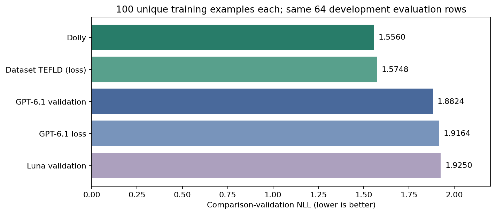
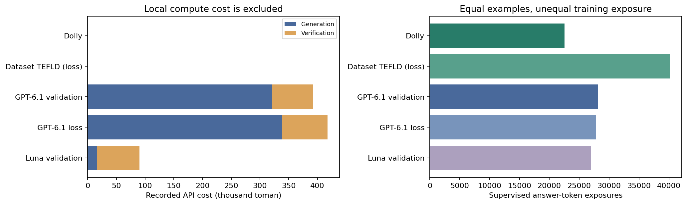
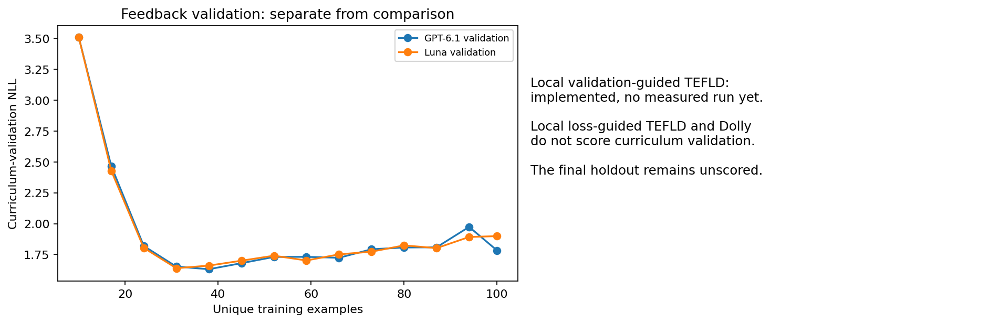
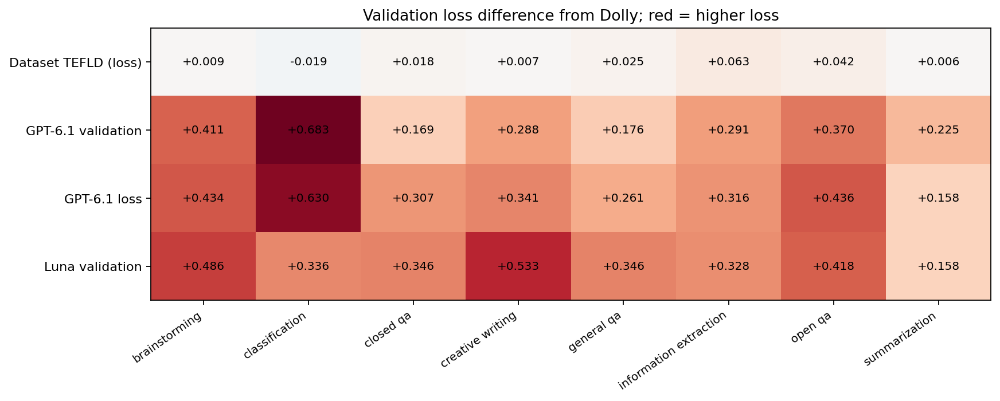

# Measured results

The current snapshot is the **October 19, 2026 five-method development study**:
100 unique training examples per arm, seed 42, the same ten-reference warmup and
the same 64 comparison-validation examples (eight per category). Every arm
reports its final checkpoint. The final holdout remains unscored.

| Method | Comparison-validation NLL ↓ | Token-weighted NLL ↓ | Training target exposures | Updates | API cost, toman |
| --- | ---: | ---: | ---: | ---: | ---: |
| Dolly | **1.555983** | **1.993431** | 22,533 | 80 | 0 |
| Dataset TEFLD, loss-guided | 1.574800 | 2.021831 | 40,155 | 111 | 0 |
| GPT-6.1 validation-guided | 1.882400 | 2.229442 | 28,176 | 111 | 392,169 |
| GPT-6.1 loss-guided | 1.916393 | 2.281715 | 27,822 | 111 | 417,776 |
| Luna validation-guided | 1.924957 | 2.372874 | 26,976 | 111 | 90,288 |

These are losses on the supplied reference answers, **not accuracy percentages**.
API costs include generation, verification and charged rejected/failed attempts;
they exclude local computing cost. Total recorded API cost is **900,233.52 toman**.



## Findings and practical limits

Ordinary Dolly has the lowest development loss. Dataset-only TEFLD is 1.2%
higher in NLL despite 78.2% more training-token exposure; it improves one of
eight categories. Each synthetic arm has higher NLL than Dolly in all eight
categories. GPT-6.1 validation is the best observed synthetic arm.

Luna's API bill is about 77% lower than GPT-6.1 validation's, with 2.3% higher
NLL. Roughly 82% of Luna's bill is the fixed GPT-6.1 verifier. One seed and 64
development examples do not establish a reliable teacher-quality ordering.



Equal unique examples do not mean equal tokens, replay, rounds or optimizer
updates. The adaptive arms each have 39 replay batch slots and 417 training
presentations; Dolly has 300 presentations. These results cannot isolate
selection, replay and optimization effects. Synthetic-data/reference-style
mismatch is a possible explanation for higher NLL, not an established cause.

## Curriculum validation is a separate view

The validation-guided synthetic arms use a different 64-example curriculum
partition during training. Both improve from 3.5106 after warmup:

| Method | Final curriculum-validation NLL |
| --- | ---: |
| GPT-6.1 validation | 1.783735 |
| Luna validation | 1.899169 |

That improvement does not imply superiority on the independent comparison
partition. **Local validation-guided TEFLD has no measured result in this
snapshot.** It is available for a fresh run in the integrated engine. Importing
a local validation file in the beta app is also not a dataset-only training mode.

The feedback curves reach their lowest region around 30–40 unique examples and
then generally rise. That motivates investigation of training exposure, replay
and scheduling; it does not prove a cause or supply an independent test score.
The reported comparison uses the final 100-example checkpoint for every arm.




## Audit and reproduction

[snapshot.json](five-way-100/snapshot.json) includes per-example validation losses,
category means, training counts, curriculum curves, candidate-bank inventories,
cost breakdowns and state/weight/source-code fingerprints. It contains no raw
training answers, validation prompts, credentials or model weights. Checkpoint
hashes, the shared evaluation contract and exposure accounting were verified
against the private source artifacts before export.

Rebuild every figure with no dataset, model or API:

```powershell
cd experiments/controlled
conda run -n hf-agents python -m pip install -r requirements-results.txt
conda run -n hf-agents python plot_results.py --snapshot ../../results/five-way-100/snapshot.json --output outputs/rebuilt-figures
```

The integration code has changed since these measurements. Its new configuration,
logging and local-validation options must not be credited with the old results.
Exact retraining requires the frozen dataset, local base model and recorded
protocol; they are not included in the compact results release.

The older root `comparison_data/` files describe a separate prototype study.
Do not combine its holdout results or round numbers with this development study.
